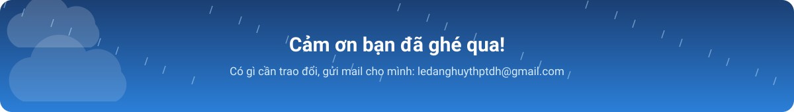

<picture>
  <source media="(prefers-color-scheme: dark)" srcset="./assets/header-dark.svg" />
  <source media="(prefers-color-scheme: light)" srcset="./assets/header-light.svg" />
  
</picture>

  

  
  
  

Mình là **Huy**, sinh viên ngành Công nghệ Thông tin ở **Đại học Trà Vinh**. Mình thích làm web: từ giao diện
HTML, CSS, JavaScript cho tới việc gọi API, xử lý dữ liệu JSON và kiểm thử để trang chạy ổn trên cả máy tính lẫn điện thoại.

   
  

<picture>
  <source media="(prefers-color-scheme: dark)" srcset="https://raw.githubusercontent.com/ledanghuyf/ledanghuyf/output/github-snake-dark.svg" />
  <source media="(prefers-color-scheme: light)" srcset="https://raw.githubusercontent.com/ledanghuyf/ledanghuyf/output/github-snake.svg" />
  
</picture>

